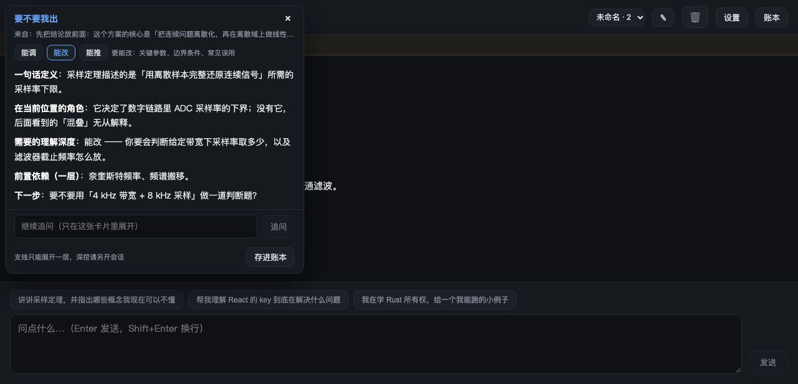

# StudyDeck · 学习卡片



把「读到不懂的词 → 就地展开 → 不丢主线 → 沉淀成账本」做成一个可运行的应用。

选中回答里的任意一段文字 → 浮出一张卡片 → 解释它**在当前这段话里**是什么角色、
你需要懂多深 → 关掉自动记账。主线对话的位置、上下文、滚动状态都不受影响。

- **针对自学**：答案先给结论，术语标「能调 / 能改 / 能推」，不一次灌完
- **账本会变厚**：命中优先、可编辑、可合并、可标掌握程度、可导出 Markdown
- **可以当别人的 agent**：`studydeck://` 深链 + `POST /api/ask`，`ask-agent.nvim` 里
  deck 和 pi / claude 平级（见 [docs/PROTOCOL.md](docs/PROTOCOL.md)）
- **本地优先**：对话直接发给你自己填的模型服务商，不经过任何中转；Key 进钥匙串

```
macOS 桌面版（自带服务与前端） · Rust + axum + SQLite · React + TS · Tauri 2
```

## 快速开始

```bash
# 1) 桌面版（推荐）
cd apps/desktop && ./make-app.sh     # 产出 target/StudyDeck.app
open ../../target/StudyDeck.app

# 2) 浏览器版
cargo run -p server                  # 打开 http://127.0.0.1:8787

# 3) 开发热更新
./dev.sh
```

首次打开会引导选服务商、填 API Key、测试连通性。**不填 Key 也能开**，进入演示模式
（脚本回复，用来验证交互）。

文档：[协议](docs/PROTOCOL.md) · [架构](docs/ARCHITECTURE.md) · [给朋友的安装说明](FRIEND.md)

---

# study-deck

把「读到不懂的词 → 就地展开 → 不丢主线 → 沉淀成账本」做成一个可运行的应用。

不是又一个聊天框：主对话是线性的，但理解不是。所以这里把**展开**从「跳转」变成「叠加」——
选中主线回答里的任意一段文字，浮出一张卡片，卡片里可以继续追问，关掉时自动记账，
主线对话的位置、上下文、滚动状态都不受影响。

## 四个机制

| 机制 | 落在哪 |
|---|---|
| **依赖清单 + 深度契约**（能调 / 能改 / 能推） | `crates/agent/src/assemble.rs` + `core::Depth` |
| **就地展开，带主线坐标**（锚点 = 字符区间 + 原文快照） | `core::Anchor` + `CardAssembler` |
| **账本**（术语 → 一句话结论 → 深度 → 来源锚点，FTS5 可检索） | `crates/store` + `GlossaryEntry` |
| **深度预算**（卡片只允许一层嵌套） | `core::NestingPolicy` |

## 结构

```
crates/core            纯领域模型：无 async、无 I/O、无 UI 依赖
crates/store           SQLite（会话 / 消息 / 卡片 / 账本 + FTS5）
crates/agent           provider（OpenAI 兼容 / 演示）+ 上下文装配 + 工具循环
crates/server          axum：HTTP + SSE；前端构建产物用 rust-embed 编进二进制
apps/web               Vite + React + TS：消息流、划词、卡片浮层、账本抽屉
apps/desktop/src-tauri Tauri 2 壳：起本地服务 + 开窗口，产物是 .app
```

依赖方向只能是：

```
apps/* ──► agent ──► core ◄── store
```

`core` 不认识网络、SQLite 和 UI。想加 CLI 或 Tauri 壳，复用的是 `agent` + `store`，
不需要动任何界面逻辑。

## 首次配置（BYOK）

桌面版和浏览器版都不会内置 Key：第一次打开会让你选服务商、填 Key、测试连通性，再保存。
Key 优先写入 **macOS 钥匙串**；钥匙串不可用时退化成 `600` 权限的本地文件，UI 会提示。

配置接口：

| 方法 | 路径 | 说明 |
|---|---|---|
| GET | `/api/settings` | 当前配置 + 是否已有 Key |
| PUT | `/api/settings` | 保存服务商 / 端点 / 模型 / Key（Key 可留空表示不修改） |
| POST | `/api/settings/test` | 用给定配置发一次最小请求，验证连通性 |
| DELETE | `/api/settings/key` | 清除已保存的 Key |
| GET | `/api/providers` | 内置服务商预设（DeepSeek / OpenAI / OpenRouter / 自定义） |
| GET | `/api/sessions` | 最近会话（UI 的会话切换器用） |
| POST | `/api/ask` | 外部投递：`{text, cwd?}`，同一 cwd 复用同一条会话，SSE 回传 |

服务启动时端口传 `127.0.0.1:0`，由系统分配，桌面壳再把真实地址交给窗口——
所以不会再出现“8787 被占用导致白屏”。

## 外部客户端协议（turn / 事件 / 取消 / 鉴权）

deck 对外的能力全部收敛到一个**轮次对象**上，不再靠"HTTP 连接是否还活着"猜状态。

**握手文件**（数据目录里的 `port`，权限 0600）：

```json
{"port": 51619, "pid": 73438, "api": 2,
 "caps": ["turns","events","cancel","sessions","glossary","export","token"],
 "token": "eea045fa…"}
```

`api` 与 `caps` 用于能力协商：老客户端读新 app 不会崩，新客户端对老 app 可以降级。

**鉴权**：除 `/api/health` 外，`/api/*` 都要求 `Authorization: Bearer <token>`。
令牌由 app 启动时随机生成，写进握手文件；SPA 从注入到 `index.html` 的
`<meta name="deck-token">` 里拿，所以网页端不需要额外分发。想关掉：`STUDYDECK_NO_AUTH=1`。

**轮次**：

| 方法 | 路径 | 说明 |
|---|---|---|
| GET | `/api/turns?active=1` | 列出轮次（状态、seq、消息 id） |
| GET | `/api/turns/{id}` | 单轮详情 |
| GET | `/api/turns/{id}/events?since=N` | 回放 + 实时 SSE，支持 `Last-Event-ID` |
| POST | `/api/turns/{id}/cancel` | 取消；DB 里落 `cancelled`，已流出文本保留 |

- 每条 SSE 帧带 `id: <seq>`，断线后按 seq 续传不会重复也不会漏。
- 一轮的开始由首帧 `turn_started {turn_id, session_id}` 宣告，同时响应头带
  `x-deck-turn` / `x-deck-session`。
- 同一会话同时只允许一轮：冲突返回 **409**，body 里带 `active_turn`。
- 客户端断开 SSE 即取消这一轮（没人要结果就别继续烧 key）。
- `messages.status` 落库：`running | ok | error | cancelled`；崩溃后启动时会把残留的
  `running` 收敛成 `error`，不会永远转圈。

## 从 Neovim（ask-agent.nvim）投递

deck 在 nvim 里是**一个普通 backend**，和 pi、claude 平级：`:AskAgent` 选中 deck 就发出去了，
队列表、批量、路由、dashboard、状态栏全部复用。

连接方式只有一条约定——**端口文件**：

```
~/Library/Application Support/dev.studydeck.app/port
{"port": 60974, "pid": 89666}
```

端口是系统分配的（避免冲突），`pid` 用来判断进程是否还活着，所以应用没开时这个 backend
会自动从 picker 里消失。nvim 侧不需要轮询 HTTP：`probe()` 只读内存里的流状态，
`working → idle` 的边沿由插件自己的状态层推断成 `done`。

投递内容是**已经渲染好的完整文本**（含 `<nvim-context>` 块），deck 原样收下、按
`cwd:` 分组到同一条会话，所以同一个仓库的提问自带连续性。

## 三种跑法

| 目标 | 命令 | 说明 |
|---|---|---|
| 桌面 App | `cd apps/desktop && ./make-app.sh` | 产出 `target/StudyDeck.app`（universal） |
| 分发 DMG | `cd apps/desktop && ./make-dmg.sh` | 产出 `target/StudyDeck-0.1.0.dmg` + sha256 |
| 浏览器 | `cargo run -p server` | 打开 <http://127.0.0.1:8787> |
| 开发热更新 | `./dev.sh` | Rust 服务 + Vite HMR |

桌面版和浏览器版跑的是**同一套前端与后端**：Tauri 壳在后台起 `studydeck_server`，
窗口指向 `http://127.0.0.1:8787`。区别只在数据目录——
桌面版用 `~/Library/Application Support/dev.studydeck.app`，CLI 版用 `./data`。

## 快速开始

```bash
# 1) 演示模式：不需要任何 Key，返回脚本内容，用来验证交互
cargo run -p server
# 打开 http://127.0.0.1:8787

# 2) 接真模型
cp .env.example .env      # 填 OPENAI_API_KEY / OPENAI_BASE_URL / OPENAI_MODEL
./run.sh
```

首次构建会比较久（axum + rusqlite bundled + tokio）。前端需要 `npm install`。

## 账本管理

账本是这个产品的资产，所以它必须可管理，而不只是可追加：

- **命中优先**：选中一段文字开卡片时，先查账本；已经有就直接给旧结论（带深度、掌握程度、日期），
  并留一个「重新生成」按钮。同一个词不会每选一次就重新花一次钱。
- **掌握程度**：未标记 / 在学 / 已掌握，点徽章循环切换。
- **编辑与删除**：卡片存下的结论可以直接改写（模型讲错时有用），也可以删。
- **合并**：同名（忽略大小写）出现多条时，一键把结论并进其中一条。
- **导出**：设置面板里可以导出 Markdown / JSON，账本不被锁死在 App 里。
- **跨会话回跳**：条目记着它来自哪条会话，点「回到来源」会先切会话再定位消息。
- **搜索**：抽屉第二个标签，搜全库对话内容（不只账本）。

结构变更走 `schema_migrations`：增量、可重放，老库会自动补列。

## 交互

1. 在主对话里提问，助理回答流式渲染。
2. **选中回答里的任意文字** → 浮出「解释这段」→ 点它。
3. 卡片在选区旁展开，默认「能改」深度，可切换 能调 / 能改 / 能推。
4. 卡片里继续追问，回答追加在同一张卡片。
5. 关闭卡片 → 自动写入账本；右侧抽屉可搜索、可跳回来源消息。
6. 卡片内文字不触发新卡片——**支线只展开一层**，深挖请另开会话。

## API

| 方法 | 路径 | 说明 |
|---|---|---|
| GET | `/api/health` | `{ok, fake, provider}`；`fake=true` 表示演示模式 |
| POST | `/api/sessions` | 新建会话 |
| GET | `/api/sessions/{id}` | 会话 + 消息 + 卡片 |
| POST | `/api/chat` | SSE 流；`mode: "main" \| "card"` |
| GET | `/api/glossary?q=` | 账本检索（FTS5，失败自动退化 LIKE） |
| POST | `/api/glossary` | 新增账本条目 |
| GET | `/api/turns?active=1` | 轮次列表（状态机） |
| GET | `/api/turns/{id}/events` | 事件回放 + 实时 |
| POST | `/api/turns/{id}/cancel` | 取消一轮 |
| GET | `/api/glossary/match?term=` | 命中优先：按术语找已有条目（精确→模糊） |
| PUT | `/api/glossary/{id}` | 改结论 / 深度 / 掌握程度 |
| DELETE | `/api/glossary/{id}` | 删条目 |
| POST | `/api/glossary/merge` | 合并重复条目 |
| GET | `/api/export?format=md\|json` | 导出账本 |
| PATCH | `/api/sessions/{id}/meta` | 重命名会话 |
| DELETE | `/api/sessions/{id}` | 删会话（账本条目保留） |
| GET | `/api/search?q=` | 全库搜对话内容 |

SSE 事件是唯一的跨层契约（`core::AgentEvent`）：
`assistant_start` / `delta` / `tool_call` / `tool_done` / `done` / `error` / `end`。

## 已知限制（有意为之）

- 单用户、无鉴权——这是本地学习工具，不是多租户服务。
- 工具只有 `clock` 一个；工具越多上下文越脏，按需再加。
- 卡片不持久化位置信息：锚点是字符区间，重排后仍能定位，但卡片浮层位置每次重算。
- 桌面版只支持 macOS（`make-app.sh` 手写 .app，没有做 Windows/Linux 打包）。
- 桌面版固定 8787 端口；与已运行的 CLI 版冲突时先停掉后者。

## 下一步（按价值排序）

1. 卡片五段式里「在当前位置的角色」质量——靠 prompt 迭代，不是靠功能。
2. 账本回填：再次撞见已记账的术语时，卡片顶部直接给结论，不再重新生成。
3. `web_search` 工具 + 引用来源块。
4. Tauri 打包（macOS 先）。
